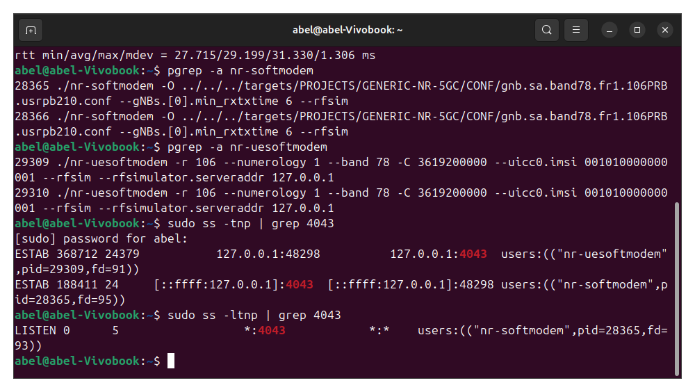
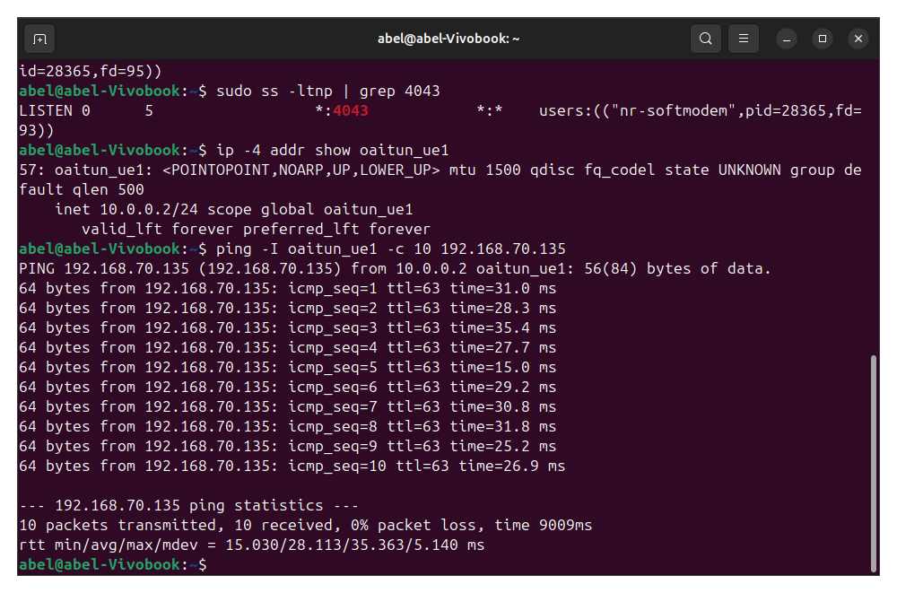
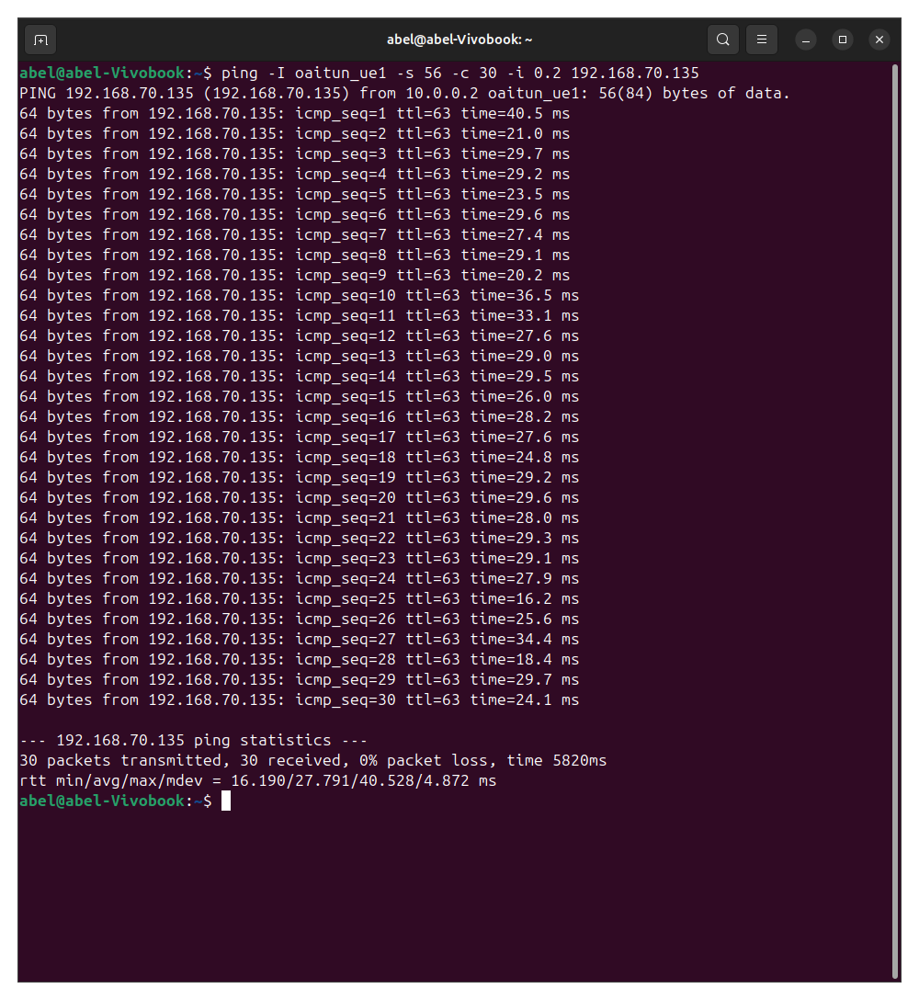
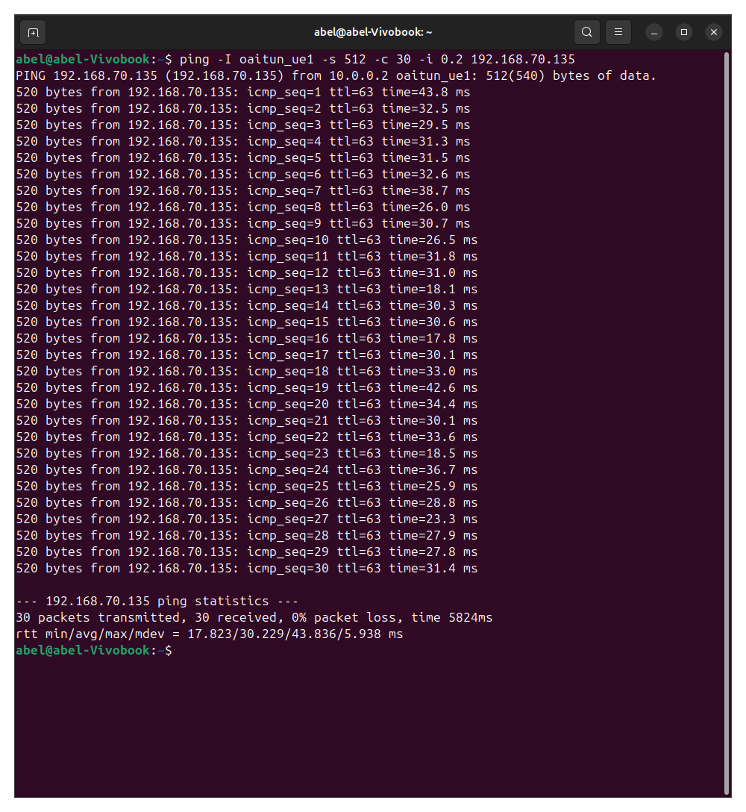
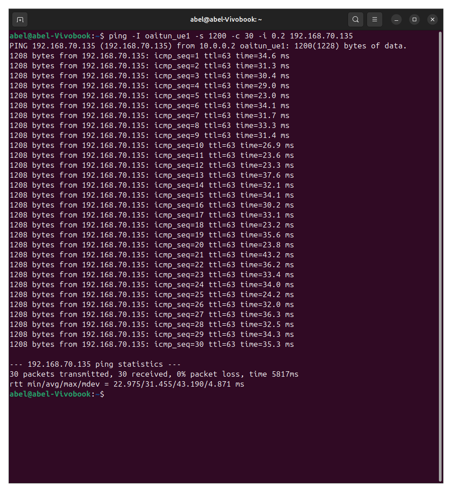
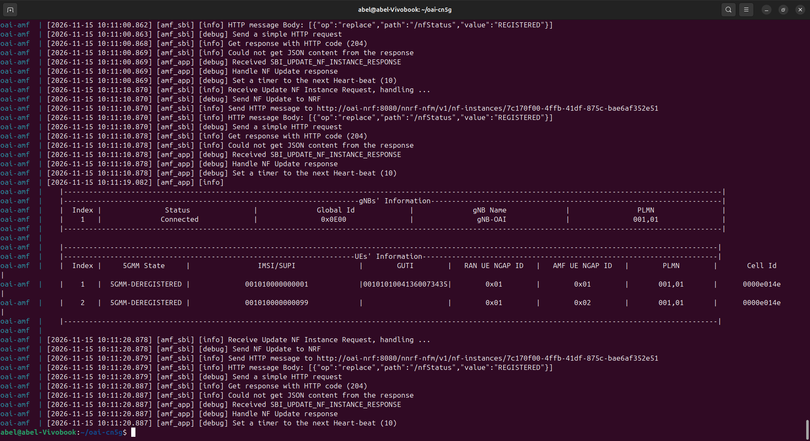
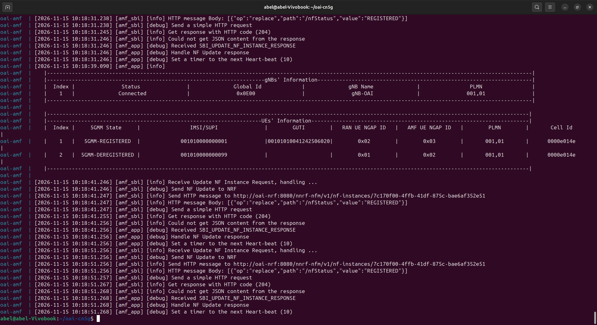
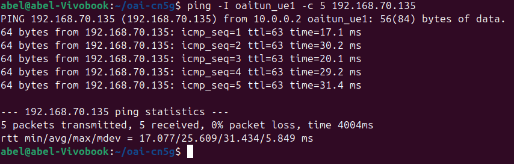

# Lab 3: Deploying a 5G Standalone Network Using OpenAirInterface

> [!NOTE]
> I used Abel's computer for the environment as it was impossible to install the correct one on my own computer but the work is my own. 

## 1. Goal

In the previous labs, you analyzed 5G signaling messages and network performance using provided captures and measurements.

In this lab, you will deploy your own 5G Standalone (SA) network using OpenAirInterface (OAI), verify the complete connection, investigate RFsimulator communication, perform active network measurements, and troubleshoot a controlled connection failure.

Unlike the previous labs, you will collect measurements directly from your own running 5G network.

**Learning Objectives**

After completing this lab, you should be able to:

1. Deploy an OAI gNB, nrUE, and 5G Core Network.
2. Identify the main stages of 5G SA connection establishment.
3. Verify communication between gNB and nrUE through RFsimulator.
4. Measure user-plane connectivity under different packet sizes.
5. Diagnose connection failures using OAI and 5GC logs.
6. Explain the limitations of a software-simulated 5G network.

## 2. Experimental Environment

Use the *OAI v2.4.0 Build Guide* to prepare the environment before class.

| Component | Configuration |
|---|---|
| Ubuntu | 24.04 |
| OAI RAN | v2.4.0 |
| 5G Core | OAI CN5G |
| gNB | nr-softmodem |
| UE | nr-uesoftmodem |
| Radio interface | RFsimulator |
| Band | n78 |
| Subcarrier spacing | 30 kHz |
| Resource blocks | 106 |
| UE IMSI | 001010000000001 |
| External DN | 192.168.70.135 |

The experiment uses one Ubuntu machine without physical RF hardware.

## 3. Task 1 — Deploy and Verify the Complete 5G SA Network

Start the OAI CN5G:

```bash
cd ~/oai-cn5g
docker compose up -d
docker compose ps
```

Start the gNB and nrUE using the commands in the Build Guide.

Observe their terminal outputs and locate evidence of the following stages.

| Stage | Successful? | Evidence from logs |
|---|---|---|
| CN5G initialization | Yes | T1: All containers appear to be running (`up`) |
| gNB NG Setup | Yes | T2: `[NGAP] Send NGSetupRequest to AMF` followed by `[NGAP] Received NGSetupResponse from AMF` |
| UE synchronization | Yes| T3: `[PHY] Initial sync successful, PCI: 0` |
| RRC connection establishment | Yes | T3: Random Access Msg1–Msg4 exchange `[MAC] [UE 0] Send PRACH`, `Received RAR`, followed by `[RRC] [UE 0] State = NR_RRC_CONNECTED` |
| UE Registration | Yes | T3: `[NAS] [UE 0] Received Registration Accept` and `Registration Complete` | 
| PDU Session Establishment | Yes | T3: `[NAS] Received PDU Session Establishment Accept`|
| UE tunnel creation | Yes | T3: `Interface oaitun_ue1 successfully configured, ip address ...` |

Take screenshots showing the gNB and UE successfully connected.

### T1 - Docker


### T2 - gNB


### T3 - UE


**Questions:**

1. Does a successful NG Setup guarantee that a UE can register? Explain.  
No. A successful NG Setup only confirms that the control-plane connection (N2/NGAP) between the gNB and the AMF is established and that basic cell parameters (like PLMN ID and TAC) match.   

2. Why can the UE establish an RRC connection but still fail Registration?  
An RRC connection only establishes a local radio link between the UE and the gNB (Access Stratum) without verifying who the subscriber is. Once connected, the UE sends a NAS Registration Request through the gNB to the AMF. Registration can then be rejected at the core network level (Non-Access Stratum) if the IMSI is missing from the subscriber database, the security keys fail 5G-AKA authentication, or the requested network slice (S-NSSAI) or tracking area is not allowed.  

3. What additional procedure is required after Registration before user data can be exchanged?  
Following Registration, the UE must initiate **PDU Session Establishment**. This creates the end-to-end user-plane data path (establishing the Data Radio Bearers over the RAN and the N3 GTP-U tunnel between the gNB and UPF), assigns an IP address to the UE, and brings up the `oaitun_ue1` virtual network interface so IP packets can reach the External Data Network.  

## 4. Task 2 — Investigate RFsimulator Communication

OAI RFsimulator replaces the physical RF interface with software-based communication.

The gNB and nrUE exchange IQ samples through a TCP connection.

Check the running processes:

```bash
pgrep -a nr-softmodem
pgrep -a nr-uesoftmodem
```

Inspect the TCP connections:

```bash
sudo ss -tnp | grep 4043
```

If necessary, inspect the listener:

```bash
sudo ss -ltnp | grep 4043
```

The default RFsimulator port in this experiment is 4043.

Complete the table:

| Item | Observed Value |
|---|---|
| gNB process ID | 28365 (a second nr-softmodem process, 28366, also appears; the one owning the TCP socket is 28365) |
| nrUE process ID | 29309 (a second nr-uesoftmodem process, 29310, also appears; the one owning the TCP socket is 29309) |
| RFsimulator transport protocol | TCP |
| RFsimulator port | 4043 |
| TCP connection state | ESTAB (established); the gNB also has the port in LISTEN state |
| Connected process(es) | nr-uesoftmodem (pid 29309) at 127.0.0.1:48298 → nr-softmodem (pid 28365) at 127.0.0.1:4043 |

Take one screenshot showing the TCP connection.



**Questions:**

1. Why does RFsimulator use a TCP connection instead of a physical antenna?  
Because there is no RF hardware in this experiment, the samples that would normally travel over the air must still be exchanged between the gNB and the UE. The RFsimulator replaces the radio channel with a TCP connection over the loopback interface (127.0.0.1, port 4043): the gNB listens on the port and the UE connects to it as a client. TCP is used because it is reliable and ordered, so the IQ samples arrive in the same sequence they were generated, which keeps the receiver's synchronization and decoding working as if a real channel existed.  

2. Are the TCP packets exchanged by RFsimulator the same as the UE's application-layer IP packets?  
No. The TCP packets carry digitized IQ samples (the raw OFDM waveforms), not user data. The UE's application-layer IP packets (for example the ICMP packets from Ping) are generated after full 5G protocol processing and are carried inside the PDU Session through the `oaitun_ue1` tunnel interface. The two data paths are completely separate: the TCP connection on port 4043 emulates the radio channel, while the user-plane IP traffic flows through the 5G core network.  

3. Does using RFsimulator mean that the UE and gNB are performing no physical-layer processing? Explain.  
No, the opposite is true. Both the gNB and the UE run the complete 5G NR physical layer in software: they generate and process OFDM symbols, perform modulation, coding, synchronization, channel estimation and decoding on the exchanged samples. What RFsimulator removes is only the analog part: real antennas, RF front-ends, and wireless propagation effects. That is why the processes we observed (`nr-softmodem`, pid 28365, and `nr-uesoftmodem`, pid 29309) consume significant CPU even though no radio hardware is present.  

## 5. Task 3 — Verify End-to-End Connectivity

Check the UE tunnel interface:

```bash
ip -4 addr show oaitun_ue1
```

Test connectivity to the External DN:

```bash
ping -I oaitun_ue1 -c 10 192.168.70.135
```

Record:

| Measurement | Observed Value |
|---|---|
| UE IP address | 10.0.0.2/24 (on interface `oaitun_ue1`) |
| Destination IP | 192.168.70.135 |
| Packets transmitted | 10 |
| Packets received | 10 |
| Packet loss (%) | 0% |
| Minimum RTT (ms) | 15.030 |
| Average RTT (ms) | 28.113 |
| Maximum RTT (ms) | 35.363 |

Take a screenshot of the Ping result.



**Questions:**

1. Why must Ping use the `oaitun_ue1` interface in this experiment?  
The UE's traffic must leave through the tunnel interface that the PDU Session created, because `oaitun_ue1` carries the UE's assigned address (10.0.0.2) and is the only path routed into the 5G core network. The host's default interface (for example its Wi-Fi or Ethernet card) has a different IP address that is not registered with the 5G core, so packets sent from it would never traverse the gNB, the AMF/UPF path, or the N3 tunnel. Forcing the interface with `-I oaitun_ue1` guarantees the ICMP packets actually cross the simulated 5G user plane.  

2. Does successful Registration guarantee successful user-plane connectivity?  
No. Registration only proves that the control plane works: the UE authenticated with the network and the AMF accepted it. User-plane connectivity additionally requires a PDU Session to be established, the UPF to allocate a UE IP address, and the GTP-U tunnel between the gNB and the UPF to be correctly configured. A UE can be fully registered yet have no data path if the PDU Session setup fails or the UPF/tunnel configuration is wrong, which is why the Ping test in this task is a separate verification step.  

3. What does a successful Ping prove, and what does it not prove about the simulated 5G system?  
A successful Ping proves that the full end-to-end user plane works: ICMP packets travel from the UE through the gNB, the GTP-U tunnel, the UPF, and out to the external Data Network, and replies come back, with 0% loss in our measurement. It does not prove that the system behaves like a real 5G deployment: there is no actual radio channel, no RF impairments, no cell-edge conditions, and the RTT (about 28 ms on average) reflects software processing and scheduling on a single machine rather than true over-the-air 5G latency. It also says nothing about realistic throughput, mobility, or behavior under load.  

## 6. Task 4 — Investigate the Effect of Packet Size

You will now investigate whether changing the ICMP packet size affects the observed RTT.

Perform three experiments using the same established 5G connection.

**Scenario A — Small Packets**

```bash
ping -I oaitun_ue1 -s 56 -c 30 -i 0.2 192.168.70.135
```

**Scenario B — Medium Packets**

```bash
ping -I oaitun_ue1 -s 512 -c 30 -i 0.2 192.168.70.135
```

**Scenario C — Large Packets**

```bash
ping -I oaitun_ue1 -s 1200 -c 30 -i 0.2 192.168.70.135
```

Note: `-s` specifies ICMP payload size, not the complete IP packet size.

Complete the table:

| Scenario | ICMP Payload | Avg. RTT (ms) | Max. RTT (ms) | Packet Loss (%) |
|---|---:|---:|---:|---:|
| A | 56 bytes | 27.791 | 40.528 | 0% |
| B | 512 bytes | 30.229 | 43.836 | 0% |
| C | 1200 bytes | 31.455 | 43.190 | 0% |

Calculate the RTT difference:

```text
RTT Difference = Average RTT(C) - Average RTT(A)
```

- `RRT Difference = 31.455 -  27.791 = 3.664 ms`

**Questions:**

1. Which scenario has the highest average RTT?  
Scenario C (1200 bytes payload) has the highest average RTT at 31.455 ms.  

2. Does increasing packet size always increase RTT in your measurements?  
Yes, in these measurements, the average RTT steadily increased as the packet payload size increased (from 27.791 ms for 56 bytes, to 30.229 ms for 512 bytes, up to 31.455 ms for 1200 bytes). However, maximum RTT values can occasionally fluctuate due to local software scheduling and CPU load (e.g., Scenario B's max RTT of 43.836 ms was slightly higher than Scenario C's 43.190 ms).  

3. Why might a larger packet require more transmission or processing resources?  
Larger packets require more bytes to be serialized, processed through the protocol stacks (IP, UDP/GTP-U, RLC, MAC, PHY), and segmented or buffered across radio resource blocks, increasing transmission time over the simulated air interface.  

4. What factors other than packet size could affect RTT in a software-based 5G network?  
Factors include host CPU scheduling jitter, background OS process load, TCP socket buffer performance of the RFsimulator, and the internal timer granularities of the virtual interfaces.  

5. Can these results be interpreted as real over-the-air 5G latency? Explain.  
No, because the RFsimulator runs locally over a software TCP loopback interface (`127.0.0.1`) rather than propagating through physical radio channels, propagation delay, real RF noise, and hardware transceiver impairments.  

Do not assume that RTT must increase with packet size. Use your measured values to support your explanation.

### Screenshots

- Scenario A


- Scenario B


- Scenario C


## 7. Task 5 — Diagnose a Controlled UE Registration Failure

In this task, you will deliberately introduce one configuration error and investigate why the UE cannot complete registration.

**Important:** Save the original successful UE command before starting. Do not modify the CN5G subscriber database.

### Step 1 — Stop the UE

Press `Ctrl+C` in the nrUE terminal. Keep the CN5G and gNB running.

### Step 2 — Launch the UE with an Incorrect IMSI

Change only the IMSI:

```bash
sudo ./nr-uesoftmodem \
  -r 106 \
  --numerology 1 \
  --band 78 \
  -C 3619200000 \
  --uicc0.imsi 001010000000099 \
  --rfsim \
  --rfsimulator.serveraddr 127.0.0.1
```

The IMSI `001010000000099` is not provisioned in the standard classroom subscriber configuration. Verify this assumption against the instructor's database before class.

Observe the UE and AMF logs.

```bash
cd ~/oai-cn5g
docker compose logs --since=2m oai-amf
```

Allow time for registration attempts, then stop the UE.

Complete the table:

| Item | Observation |
|---|---|
| Modified parameter | `--uicc0.imsi` (changed from `001010000000001` to `001010000000099`) |
| UE synchronized with gNB? | Yes |
| RRC connection established? | Yes |
| Registration successful? | No |
| Error or rejection evidence | In the `oai-amf` UEs' Information table, Index 2 (`IMSI/SUPI: 001010000000099`) shows a `5GMM State` of `5GMM-DEREGISTERED` with no assigned `GUTI`, while `RAN UE NGAP ID` (`0x01`) and `AMF UE NGAP ID` (`0x02`) were allocated. |
| Likely cause | The IMSI `001010000000099` is not provisioned in the 5G Core subscriber database (UDM/AUSF), causing authentication/registration to fail. |

If the expected registration rejection does not appear, report the actual logs instead of inventing a failure message.



### Step 3 — Restore the Original IMSI

Restart the nrUE using:

```text
--uicc0.imsi 001010000000001
```

Confirm that the UE successfully registers again and that Ping works.





**Questions:**

1. Why can the UE potentially synchronize with the gNB even when the IMSI is incorrect?  
The UE synchronizes with the gNB at the physical and medium access control (PHY/MAC) layers by detecting synchronization signals and primary/secondary synchronization signals (PSS/SSS) and reading system information blocks (SIB1), which are broadcasted by the gNB for all cells independently of subscriber identity.  

2. Which network function is involved in UE authentication?  
The Authentication Server Function (AUSF) working together with the Unified Data Management (UDM) is responsible for processing authentication credentials and verifying the UE identity during registration.  

3. Why does changing an IMSI affect Registration but not the RFsimulator TCP connection itself?  
The RFsimulator TCP connection operates purely at the transport layer to exchange physical-layer IQ samples between the gNB and nrUE binaries, whereas the IMSI is part of higher-layer 5G Non-Access Stratum (NAS) identity and security negotiations processed inside the core network after the radio link is established.  

4. What evidence proves that restoring the correct configuration solved the problem?  
Restoring the correct IMSI allowed the UE to transition its 5GMM State to 5GMM-REGISTERED with an assigned GUTI in the AMF logs, and successfully re-established end-to-end IP data transmission with zero packet loss during ping tests.  

Submit evidence from both the failed and recovered connections. (ABOVE)

## 8. Task 7 — Explain the Relationship Between Simulation and Real 5G

Your OAI gNB and nrUE perform 5G NR protocol processing even though they do not use physical antennas.

Complete the comparison:

| Feature | OAI RFsimulator | Physical 5G System |
|---|---|---|
| gNB and UE protocol stack | Fully functional software implementation of 5G NR layers (PHY, MAC, RLC, PDCP, RRC, SDAP) | Fully functional implementation running on dedicated hardware and firmware |
| OFDM signal processing | Calculated in software via baseband signal generation and processing functions | Processed in real-time by digital signal processors (DSPs) and FPGA/ASIC hardware |
| Physical antennas | None (replaced by socket-based virtual communication) | Required at both gNB and UE for spatial transmission and reception |
| RF hardware impairments | Absent or completely idealized (no phase noise, power amplifier non-linearity, or thermal noise) | Present (includes amplifier distortion, phase noise, IQ imbalance, and thermal noise) |
| Wireless propagation effects | Idealized or simulated via basic software channel models (no real multipath fading, shadowing, or external interference) | Subject to real-world multipath fading, path loss, Doppler shift, shadowing, and interference |
| 5G Core connectivity | Fully connected via virtual network interfaces and containerized network functions | Connected via physical transport networks (F1/NG interfaces over Ethernet/fiber) |

**Questions:**

1. Which parts of the 5G system remain functional when physical RF hardware is replaced with RFsimulator?  
The entire 5G Core Network (AMF, SMF, UPF, AUSF, UDM, NRF) and the complete 5G NR protocol stack of both the gNB and nrUE—including SDAP, PDCP, RLC, MAC, RRC, NAS, and baseband OFDM digital signal processing—remain fully functional.  

2. Why is RFsimulator useful for testing the 5G protocol stack?  
RFsimulator eliminates the high cost, hardware complexity, and RF interference issues of physical SDR transceivers and antennas, allowing developers and students to verify end-to-end 5G signaling, protocol state transitions, core network integration, and user-plane data flow on a single standard machine.  

3. Why might latency and throughput differ between RFsimulator and a real 5G deployment?  
Latency and throughput differ because RFsimulator runs in software over a local TCP loopback socket, making performance heavily dependent on host CPU speed, OS thread scheduling jitter, and socket buffer overhead, rather than dedicated real-time FPGA/ASIC hardware and physical over-the-air radio propagation delays, noise, and channel fading.  

4. What would need to change if you wanted to test a physical UE instead of OAI nrUE?  
You would need to replace the RFsimulator software interface with physical SDR hardware (such as a USRP) connected to antennas at the gNB, configure real RF parameters (transmit/receive gain, physical frequency bands, and hardware clock synchronization), and provision a physical programmable SIM card with matching IMSI, Ki, and OPc credentials into the physical UE.  


## 9. Final Analysis

Answer each question in three to five sentences.

1. Describe the complete process from starting the OAI 5GC to successful user-plane connectivity.
2. Explain the difference between an RFsimulator TCP connection and a 5G PDU Session.
3. Based on your measurements, how did packet size affect RTT and packet loss?
4. Describe the registration failure you introduced and explain how you diagnosed and recovered from it.
5. Identify two limitations of this simulated environment and explain how they might affect experimental results.

Questions:

1. Describe the complete process from starting the OAI 5GC to successful user-plane connectivity.  
First, the OAI 5G Core Network is initialized using Docker Compose (`docker compose up -d`), spinning up containerized network functions such as the AMF, SMF, UPF, and UDM. Next, the gNB (`nr-softmodem`) is started, establishing NGAP connectivity and performing an NG Setup procedure with the AMF. Following that, the user equipment emulator (`nr-uesoftmodem`) is launched, which synchronizes with the gNB via RFsimulator, completes RRC connection establishment, performs NAS UE Registration and authentication, and triggers PDU Session Establishment. Finally, the virtual network interface (`oaitun_ue1`) is created on the host, allowing end-to-end user-plane IP traffic to flow successfully between the UE and the external data network.  

2. Explain the difference between an RFsimulator TCP connection and a 5G PDU Session.  
An RFsimulator TCP connection operates at the transport layer over loopback to exchange raw baseband IQ samples between the gNB and nrUE software binaries, replacing physical radio waves. In contrast, a 5G PDU Session is a logical end-to-end connection established at the core network layer between the UE and the User Plane Function (UPF), providing IP connectivity and encapsulation for actual user data packets.  

3. Based on your measurements, how did packet size affect RTT and packet loss?  
Based on the ping experiments, increasing the ICMP payload size from 56 bytes to 512 bytes and 1200 bytes resulted in a steady increase in average RTT (rising from 27.791 ms to 30.229 ms and 31.455 ms, respectively), as larger payloads require more transmission and serialization resources. However, packet loss remained consistently at 0% across all scenarios, indicating stable transport performance over the simulated link.  

4. Describe the registration failure you introduced and explain how you diagnosed and recovered from it.  
The registration failure was introduced by modifying the UE configuration to use an invalid, unprovisioned IMSI (`001010000000099`). Although the UE still synchronized with the gNB and established an RRC connection, the AMF logs showed that registration failed, leaving the UE in a `5GMM-DEREGISTERED` state because the core network could not authenticate the unknown subscriber. Diagnosis was performed by inspecting the AMF user status table via container logs, and recovery was achieved by restoring the original valid IMSI (`001010000000001`), which immediately allowed the UE to register successfully and resume ping traffic.  

5. Identify two limitations of this simulated environment and explain how they might affect experimental results.  
First, the use of RFsimulator over a local TCP loopback interface completely eliminates real-world radio propagation effects such as path loss, multipath fading, Doppler shift, and atmospheric noise, which would normally cause fluctuations and packet loss in a real deployment. Second, because all network functions, RAN components, and UEs run as software processes on a single host machine, host CPU scheduling jitter and resource contention directly impact latency measurements, meaning experimental RTT values do not reflect true over-the-air 5G timing.  

## 10. Submission Checklist

Submit one Markdown or PDF report containing:

- Completed 5G SA connection verification table.
- gNB and nrUE connection screenshots.
- RFsimulator TCP connection evidence.
- Baseline Ping measurement.
- Three packet-size comparison results.
- RTT difference calculation.
- Controlled failure and recovery evidence.
- RFsimulator versus physical 5G comparison.
- Answers to the final analysis questions.

All measurements and log evidence must come from your own experimental environment.

## 11. Grading Rubric

| Item | Points |
|---|---:|
| Complete 5G SA deployment | 15 |
| RFsimulator TCP connection analysis | 15 |
| End-to-end user-plane verification | 15 |
| Packet-size experiment and analysis | 20 |
| Controlled failure and recovery | 20 |
| Simulation limitations and final analysis | 15 |
| **Total** | **100** |

Vote TOP3：https://forms.gle/Mvza68DFBzPcZXfW6
