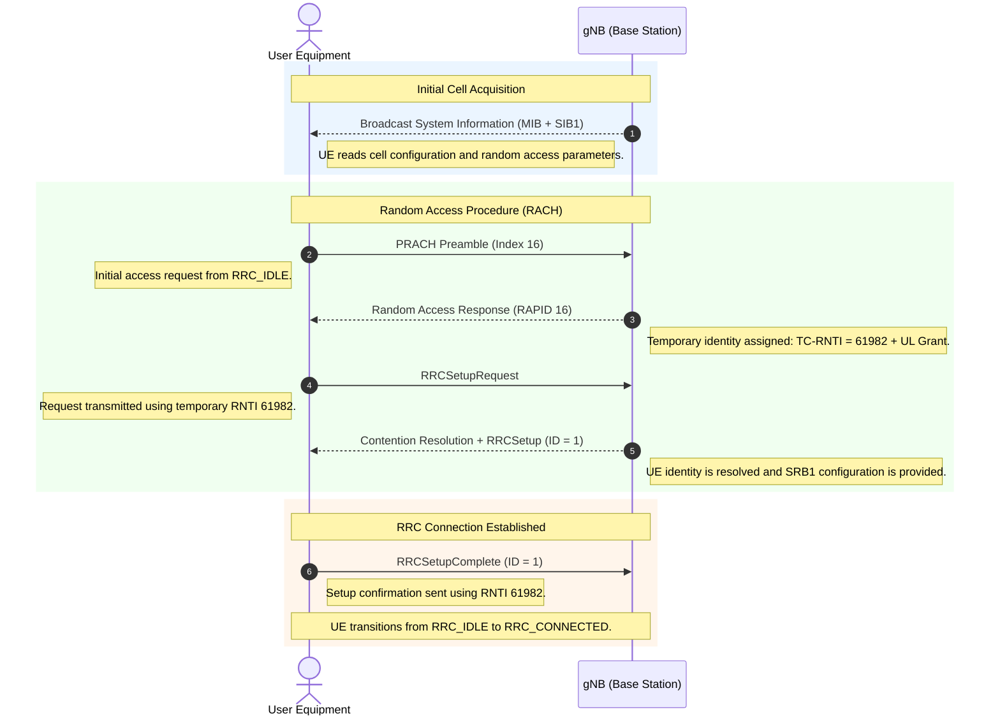

# Lab 5: From Initial Access to RRC Connection Setup (Student Guide)

## 1. Lab Goal

In Lab 1, you observed UE registration with the 5GC and the establishment of data service. This lab moves the observation point earlier: before registering with the Core network, how does a UE find a gNB, obtain cell system information, perform Random Access, and finally establish an RRC connection?

The main procedure in this lab is:

```text
Cell search / initial synchronization
→ MIB / SIB1
→ Msg1 PRACH
→ Msg2 RAR
→ Msg3 RRCSetupRequest
→ Msg4 RRCSetup
→ RRCSetupComplete
→ RRC_CONNECTED
```

This lab ends at `RRC_CONNECTED`. NAS Registration, Authentication, and PDU Session establishment belong to the Core network scope covered in Lab 1.

## 2. Evidence Used in This Lab

You will receive three files produced by the same successful OAI run:

| File | Purpose |
|---|---|
| `Lab5-ue.log` | Observe UE cell search, synchronization, PRACH, and RRC state. |
| `Lab5-gnb.log` | Cross-check gNB-side behavior when needed. |
| `Lab5.pcap` | Use Wireshark to observe MIB, SIB1, RAR, and RRC messages. |

You are not required to start OAI for this lab. Your main task is to reconstruct and explain the access procedure using the supplied log and PCAP files. Section 7 provides optional steps for reproducing the files yourself.

## 3. Learning Objectives

After completing this lab, you should be able to:

1. Explain the UE procedure from Cell Search to `RRC_CONNECTED` in the correct order.
2. Distinguish the roles of broadcast system information, Random Access, and RRC Connection Setup.
3. Obtain complementary evidence from a UE log and a Wireshark MAC-NR trace.
4. Explain the meaning of `RRC_CONNECTED` and how it differs from 5GC Registration.

## 4. Open the Supplied Files

Perform all analysis from the `openairinterface5g` repository root. Put the three supplied files in `lab5-artifacts/`, or in another location of your choice. If you use another location, adjust the paths in the commands accordingly.

```text
lab5-artifacts/Lab5-ue.log
lab5-artifacts/Lab5-gnb.log
lab5-artifacts/Lab5.pcap
```

Open `lab5-artifacts/Lab5.pcap` in Wireshark.

If Wireshark shows only UDP packets or the `nr-rrc` filter does not work, complete the following setup once:

1. Open **Analyze → Enabled Protocols...**, search for, and enable `MAC-NR-FRAMED`.
2. Open **Preferences → Protocols → MAC-NR** and enable NR RRC decoding for BCCH/CCCH data.
3. Open **Preferences → Protocols → RLC-NR** and enable RRC decoding for CCCH data and AM reassembly.
4. Close and reopen the PCAP.

## 5. Submission and Grading

Add a brief explanation below every screenshot. You do not need to draw boxes or arrows on screenshots.

### Task 1: From Cell Search to Msg2 RAR — 35 points

Complete the following four steps in order. For each step, provide the requested values or screenshots and briefly explain what the evidence shows and why it matters in the access procedure.

#### Step 1: Find Cell Search and Initial Synchronization — 8 points

Run the following command on `Lab5-ue.log`:

```bash
grep -nE 'Starting cell search|Initial sync successful' lab5-artifacts/Lab5-ue.log
```

Record whether UE synchronization succeeded and the PCI value. Explain: after completing initial synchronization, what is the UE able to do?


> UE sync succeeded and the PCI value is 0.  
> After completing the initial sync, the UE is able to decode the PBCH, which carries the MIB.

#### Step 2: Find MIB and SIB1 — 8 points

In Wireshark, enter:

```text
nr-rrc
```

Find one `MIB` packet and one `SIB1` packet. Record the frame number of each and provide screenshots.


> In the image, we see that packet 2 is a `MIB` packet and that packet 3 is an `SIB1` packet. 

MIB and SIB1 are repeatedly broadcast system-information messages. The UE must obtain the common configuration before it can continue the access procedure. Briefly explain the purpose of MIB and SIB1 for UE access.

> It is the MIB → SIB1 chain which enables the UE to monitor PDCCH and perform the random access procedure to establish an RRC connection. MIB tells the UE where to look. SIB1 tells the UE how to access the cell.

#### Step 3: Find Msg1 PRACH — 8 points

Run the following command on the UE log:

```bash
grep -nE 'PRACH' lab5-artifacts/Lab5-ue.log
```

Record the Msg1 log line number. From the line that shows the actual PRACH transmission, find:

```text
frame.slot = 553.19
preambleIndex = 16
```

Next, return to Wireshark. Clear the display filter, press `Cmd/Ctrl + F`, choose **Packet details** as the search scope, and search for:

```text
RACH Preamble chosen
```

After locating the PRACH event recorded by the gNB tracer, record:

```text
RAPID = 16
```

This packet is displayed as `MAC-LTE RACH Preamble chosen`; it is the OAI tracer MAC-event format.

Submit one UE-log screenshot and one Wireshark screenshot. Briefly answer:

##### UE-log


##### Wireshark


1. Which Random Access message is this PRACH transmission?
> It is **Msg1** of the 4-step random access procedure. The UE sends a preamble on a PRACH occasion to request access; at this point no UE-specific uplink grant exists yet, so Msg1 is a contention-based request sent on configured resources from SIB1's RACH configuration.

2. At which `frame.slot` and with which `preambleIndex` does the UE log show transmission?
> From the following line in `lab5-ue.log`:  
> 81:[PHY]    PRACH [UE 0] in frame.slot 553.19, placing PRACH in position 2828, Msg1/MsgA-Preamble frequency start 0 (k1 0), preamble_offset 3, first_nonzero_root_idx 0, preambleIndex = 16  
> We see that `frame.slot = 553.19` and `preambleIndex = 16`. 

3. Does the Wireshark `RAPID` match the UE-log `preambleIndex`? What does this show?
> `RAPID` does match `preambleIndex`. This shows that the preamble the UE reports transmitting on frame.slot 553.19 is the same preamble the gNB detected and associated with its response. It is a cross-check between two independent views of the same Msg1. 

#### Step 4: Find Msg2 RAR in Wireshark — 11 points

Return to Wireshark and clear the display filter. Press `Cmd/Ctrl + F`, choose **Packet details** as the search scope, and search for `RAR` or `Random Access Response`. After locating the packet, record its frame number and find the following values in `MAC-NR RAR`:


```text
RAPID = 16
Temporary C-RNTI = 61982
```

### Task 2: Complete Random Access and RRC Connection Setup — 40 points

Complete the following steps in order. For each message, provide a screenshot and record the requested frame number, fields, and brief explanation.

#### Step 1: Find RRCSetupRequest — 10 points

In Wireshark, use:

```text
nr-rrc.rrcSetupRequest_element
```

Expand `UL-CCCH-Message → rrcSetupRequest` and find:

```text
Frame number = 491
Context RNTI = 61982
```


Briefly answer:

1. Does the `Context RNTI` match the `Temporary C-RNTI` in the Task 1 / Step 4 RAR? What does this show?
> `Context RNTI` does match the `Temporary C-RNTI` in the Task 1. This confirms that the UE transmitted Msg3 (RRCSetupRequest) on the uplink grant scheduled in the RAR and using the identity the gNB assigned in that same RAR.

2. Can you claim that the RRC connection has been established after seeing only `RRCSetupRequest`? Why or why not?
> No, `RRCSetupRequest` is only a **request**: it just tells the gNB the UE wants to establish an RRC connection (via CCCH, carrying the UE's contention-resolution identity and establishment cause). The gNB has not yet accepted it.

#### Step 2: Find RRCSetup — 10 points

Clear the previous filter and enter:

```text
nr-rrc.rrcSetup_element
```

Expand `DL-CCCH-Message → rrcSetup` and find:

```text
Frame number = 492
Context RNTI = 61982
rrc-TransactionIdentifier = 1
```


Check whether `Contention Resolution` also appears in the packet.
> It does, as seen in the screenshot. 

Below the screenshot, briefly answer:

1. Which message is this in four-step Random Access?
> This is Msg4. It is the downlink message sent by the gNB that combines two things in one MAC PDU: the MAC Control Element for contention resolution (echoing back the UE Contention Resolution Identity the UE included in Msg3) and the RRCSetup message itself (carried on CCCH, LCID 0 in the subheader). With Msg4, the gNB grants the connection, configures SRB1 (srb-Identity: 1 in the srb-ToAddModList), and resolves contention in a single transmission.

2. What does it mean that `Contention Resolution` and `RRCSetup` appear in the same downlink message?
> It means the gNB is resolving contention and accepting the connection at the same time. The Contention Resolution CE echoes the identity the UE transmitted in Msg3, so the UE can verify that it (not another UE with the same preamble) won the contention; once it matches, the Temporary C-RNTI from Msg2 is promoted to the UE's C-RNTI, which is why this packet already shows the Context RNTI (61982). Because the same PDU also carries RRCSetup, the gNB's acceptance of this UE and the delivery of its dedicated radio configuration are one atomic step: the UE that validates the Contention Resolution Identity applies the SRB1 configuration and answers with RRCSetupComplete (with rrc-TransactionIdentifier = 1 matching this transaction), which completes the move from RRC_IDLE to RRC_CONNECTED.

#### Step 3: Find RRCSetupComplete — 12 points

Clear the previous filter and enter:

```text
nr-rrc.rrcSetupComplete_element
```

Select the packet and first verify that `MAC-NR UL-SCH` appears at the top. Expand:

```text
RLC-NR → PDCP-NR → NR Radio Resource Control (RRC) protocol
  → UL-DCCH-Message → message: c1
```

Expand `message: c1` further and confirm that it contains `rrcSetupComplete`. Record:

```text
Frame number = 498
Context RNTI = 61982
rrc-TransactionIdentifier = 1
```


Below the screenshot, briefly answer:

1. Does the `Context RNTI` still match the `Temporary C-RNTI` in the RAR?
> Yes it does.

2. Does the `rrc-TransactionIdentifier` match the `RRCSetup` in Step 2? What is the purpose of this comparison?
> Yes it does. Matching the rrc-TransactionIdentifier links the UE's RRCSetupComplete response directly to the corresponding RRCSetup request issued by the gNB, preventing ambiguity if multiple RRC procedures occur or overlap.

#### Step 4: Confirm the Final Random Access and RRC Connection Result — 8 points

Run the following command on the UE log:

```bash
grep -nE '4-Step RA procedure succeeded|Received NR_RRCSetup|RRCSetupComplete|State = NR_RRC_CONNECTED' \
  lab5-artifacts/Lab5-ue.log
```

From the output, record:

```text
4-Step RA procedure succeeded: line 87
Received NR_RRCSetup: line 88
State = NR_RRC_CONNECTED: line 90
Generating RRCSetupComplete: line 93
```


Submit a screenshot of this log output and briefly answer:

1. In log order, what are the three events from successful Random Access to generating `RRCSetupComplete`?
> The three events from successful Random Access to generating `RRCSetupComplete` are receiving `NR_RRCSetup` on DL-CCCH (SRB0) at line 88, transitioning to `State = NR_RRC_CONNECTED` at line 90, and generating `RRCSetupComplete` (33 bytes) on UL-DCCH (SRB1) at line 93.

2. What do `4-Step RA procedure succeeded` and `State = NR_RRC_CONNECTED` each prove?
> `4-Step RA procedure succeeded` proves the UE's MAC layer completed contention-based random access and contention resolution to establish initial uplink synchronization and a valid RNTI, while `State = NR_RRC_CONNECTED` proves the RRC layer entered the connected state after receiving `NR_RRCSetup` so it can send `RRCSetupComplete` over SRB1. 

### Task 3: Draw an Initial Access MSC Diagram — 25 points

Using the log and Wireshark evidence found in Tasks 1 and 2, draw your own Message Sequence Chart (MSC). It must include two vertical lifelines, `UE` and `gNB`, and the following six messages: MIB/SIB1, Msg1, Msg2, Msg3, Msg4, and `RRCSetupComplete`.

Determine and draw the correct order and direction of the messages yourself. Add a one-sentence purpose next to each arrow.



| Item | Points |
|---|---:|
| UE and gNB lifelines, with the two UE states identified | 5 |
| Complete message order: MIB/SIB1, Msg1, Msg2, Msg3, Msg4, RRCSetupComplete | 12 |
| Correct direction for every message arrow | 5 |
| Reasonable brief purpose for every major stage | 3 |
| **Task 3 subtotal** | **25** |

| Item | Points |
|---|---:|
| Task 1: Initial Access evidence timeline | 35 |
| Task 2: Key-message analysis | 40 |
| Task 3: Initial Access MSC diagram | 25 |
| **Total** | **100** |

## 7. Optional: Reproduce the Log and PCAP Files

This section is not required for the assignment. If you want to generate the same kind of evidence using your own OAI run, follow these steps in an OAI/5GC environment that was already set up in an earlier class.

The commands below assume that you are currently in the `openairinterface5g` repository root. Use three terminals and first create a directory for the artifacts:

```bash
mkdir -p lab5-artifacts
```

### Terminal A: Start the gNB and Wait for the Tracer

```bash
cd cmake_targets/ran_build/build

sudo -E env RFSIMULATOR=server ./nr-softmodem \
  -O ../../../ci-scripts/conf_files/gnb.sa.band78.106prb.rfsim.conf \
  --rfsim --T_stdout 2 \
  2>&1 | tee ../../../lab5-artifacts/Lab5-gnb.log
```

### Terminal B: Record the gNB MAC/RRC Trace

```bash
cd cmake_targets/ran_build/build

./common/utils/T/tracer/record \
  -d ../../../common/utils/T/T_messages.txt \
  -o ../../../lab5-artifacts/Lab5-gnb-wireshark.raw \
  -on WIRESHARK
```

The gNB in Terminal A continues after the tracer connects.

### Terminal C: Start the UE and Save the UE Log

```bash
cd cmake_targets/ran_build/build

sudo -E RFSIMULATOR=127.0.0.1 ./nr-uesoftmodem \
  -O ../../../targets/PROJECTS/GENERIC-NR-5GC/CONF/ue.conf \
  --rfsim -r 106 --numerology 1 --band 78 -C 3619200000 \
  2>&1 | tee ../../../lab5-artifacts/Lab5-ue.log
```

After `State = NR_RRC_CONNECTED` appears, wait a few seconds, then stop the terminals in this order: recorder in Terminal B, UE in Terminal C, and gNB in Terminal A.

### Convert the Trace to a Wireshark PCAP

```bash
cd cmake_targets/ran_build/build

./common/utils/T/tracer/macpdu2wireshark \
  -d ../../../common/utils/T/T_messages.txt \
  -i ../../../lab5-artifacts/Lab5-gnb-wireshark.raw \
  -to-file ../../../lab5-artifacts/Lab5.pcap
```

You should obtain:

```text
lab5-artifacts/Lab5-ue.log
lab5-artifacts/Lab5-gnb.log
lab5-artifacts/Lab5.pcap
```
